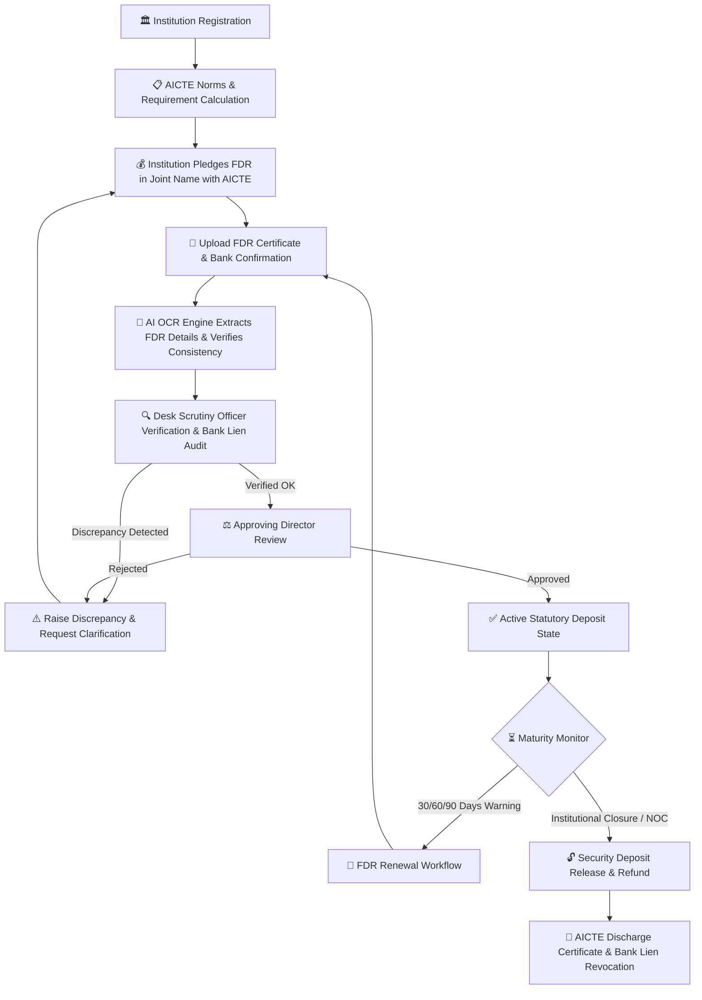

# 🏛️ AICTE Security Deposit & FDR Lifecycle Management Portal

> **National Statutory Digital Ledger & Multi-Tier Governance System for Institutional Fixed Deposit Receipts (FDR) and Security Deposits**  
> *Developed for the All India Council for Technical Education (AICTE), Ministry of Education, Government of India.*

---

## 📌 Executive Summary

Every technical institution approved by the **All India Council for Technical Education (AICTE)** is mandated to pledge a Fixed Deposit Receipt (FDR) in joint name with the **Member Secretary, AICTE** as a statutory security deposit. Historically, handling tens of thousands of paper FDRs across regional offices posed severe bottlenecks: unmonitored maturities, unrenewed deposits, lien-marking discrepancies with banks, and delayed releases during program closures.

The **AICTE Security Deposit & FDR Lifecycle Portal** replaces disparate manual ledgers with a unified, state-of-the-art enterprise digital ecosystem. It provides:
- **Joint Bank Lien Verification** with automated tripartite confirmation.
- **AI-Powered OCR Intelligence** for instant document data extraction.
- **Automated Maturity Forecasting** (30 / 60 / 90 days countdown alerts).
- **Multi-Tier Institutional Governance** (Institutional Staff ➔ Scrutiny Officer ➔ Approving Director ➔ Audit Inspection).
- **Clean White Theme UI** designed for high clarity, accessibility, and speed.

---

## 🔑 Login Credentials & Demo Role Presets

The system includes pre-configured demo users across all governance tiers. All seed accounts use the default password: **`Admin@123`**.

> [!TIP]
> On the **Login Page (`/login`)**, click on any role chip under **"Demo Credentials"** to autofill the form instantly!

| Role Name | Official Email | Password | Access Scope & Responsibilities |
| :--- | :--- | :--- | :--- |
| **Super Admin (Lead IT)** | `admin@gmail.com` | `Admin@123` | Full portal administration, user/role management, system audit logs, and master settings. |
| **Verification Officer** | `ramesh.kumar@aicte-india.org` | `Admin@123` | First-level desk scrutiny, bank lien checklist validation, and discrepancy resolution. |
| **Senior Verification Officer** | `ananya.sharma@aicte-india.org` | `Admin@123` | High-value deposit scrutiny, compliance validation, and escalation handling. |
| **Approving Authority (Regional Dir)** | `director.approvals@aicte-india.org` | `Admin@123` | Final executive approval or rejection of FDR pledges, renewals, and deposit releases. |
| **Lead Auditor (FCA)** | `audit.officer@aicte-india.org` | `Admin@123` | Read-only compliance audits, statutory reconciliation reports, and financial tracking. |
| **College Admin (CEG Anna Univ)** | `dean.ceg@annauniv.edu` | `Admin@123` | Institutional dashboard, FDR submission, deficit resolution, and renewal tracking for CEG. |
| **College Finance Staff (CEG)** | `finance.ceg@annauniv.edu` | `Admin@123` | Document uploading, FDR entry, bank receipt attachments, and NOC requests. |
| **College Admin (PSG Tech)** | `principal@psgtech.edu` | `Admin@123` | Institutional management for PSG College of Technology (`INST-PSG-002`). |
| **College Admin (VIT Vellore)** | `registrar@vit.ac.in` | `Admin@123` | Institutional management for Vellore Institute of Technology (`INST-VIT-005`). |
| **College Admin (NIT Trichy)** | `director@nitt.edu` | `Admin@123` | Institutional management for National Institute of Technology Trichy (`INST-NITT-007`). |

---

## 🔄 End-to-End System Workflow

The following flowchart illustrates the complete lifecycle of a security deposit within the portal:



---

## 📦 Core Modules & Functional Capabilities

### 1. 🔐 Modern Authentication & Role-Based Access Control (RBAC)
- **Aesthetic White Theme**: Designed with clear alignment, rounded components (`rounded-[2.5rem]`), clean typography, and a modern biometric illustration.
- **One-Click Demo Switcher**: Instant role autofill buttons for evaluation, testing, and viva demonstration.
- **JWT Authentication**: Secure Bearer tokens with automated expiration checking and bcrypt password hashing.

### 2. 🏛️ Institutional Master & Directory (`/institutions`)
- Maintains complete technical institution profiles with AICTE Permanent IDs, AISHE Codes, University affiliations, and accredited tiers.
- Live compliance status: **Compliant**, **Deficit Identified**, or **Under Scrutiny**.
- Contact details for Principal/Dean, Registrar, and Finance officers.

### 3. 📋 Security Deposit Norms & Requirements (`/requirements`)
- Computes mandated security deposit amounts based on institutional category (Engineering, Management, Pharmacy, Architecture, etc.) and approved student intake capacity.
- Real-time deficit calculations against total pledged deposits.

### 4. 🏦 FDR Registry & Pledge Management (`/fdrs`)
- Tracks individual Fixed Deposit Receipts:
  - Bank Name, Branch, IFSC, FDR Serial Number.
  - Joint account holder verification (*"Institution Name & Member Secretary, AICTE"*).
  - Principal Deposit Amount, Tenure (years/months), ROI (%), and Date of Maturity.
  - Multi-page PDF/image document preview and bank endorsement letter attachments.

### 5. 🔍 Desk Scrutiny & Verification Pipeline (`/verifications`)
- Two-way verification checklist for AICTE Desk Scrutiny Officers:
  - Bank joint title endorsement.
  - Non-encumbrance / non-lien certification.
  - Premature withdrawal restriction clause.
- Integrated Discrepancy Management: Scrutiny officers can flag discrepancies, pause approvals, and track institutional resolutions in real-time.

### 6. ⚖️ Executive Approval Workflow (`/approvals`)
- Hierarchical review system for Regional Directors and Approving Authorities.
- Single-click digital signature authorization or formal rejection with scrutiny audit remarks.
- Tamper-proof digital approval stamp recorded in the institutional ledger.

### 7. ⏳ Automated Maturity Forecasting & Tracking (`/maturity`)
- Visual countdown tracking for all maturing FDRs categorized into **Critical (< 30 days)**, **Upcoming (30-60 days)**, and **Future (60-90 days)**.
- Prevents auto-liquidation by commercial banks into low-interest savings accounts.

### 8. 🔄 FDR Renewal Engine (`/renewals`)
- Facilitates term extensions, interest rate adjustments, and rolling renewals.
- Automatic creation of renewed FDR chains preserving parent-child audit lineage.

### 9. 🔓 Security Deposit Release & NOC Module (`/releases`)
- End-to-end processing for deposit refund upon program discontinuation or approved closure.
- Automated deduction calculations for outstanding penalties or statutory dues.
- Generates official AICTE Discharge Letter authorizing commercial banks to release the lien.

### 10. 🤖 AI OCR Intelligence Engine (`/ai-intelligence`)
- Scans uploaded bank FDR certificates using optical character recognition (OCR).
- Extracts Bank Name, FDR Number, Amount, Maturity Date, and IFSC Code automatically.
- Displays confidence score percentages and highlights discrepancies against form entries.

### 11. 📊 Executive Analytics & Statutory Reports (`/reports`)
- Comprehensive charts: State-wise deposit distribution, maturity timeline forecasts, and compliance ratios.
- One-click CSV/Excel export for parliamentary inquiries and annual audits.

### 12. 👥 User & Access Governance (`/users`, `/roles`)
- Centralized administrator panel to create, deactivate, and assign granular permissions across regional offices.

---

## 💻 Technology Stack

| Layer | Technologies Used |
| :--- | :--- |
| **Frontend UI** | React 18, TypeScript, Vite, Tailwind CSS, Lucide React Icons |
| **Data Fetching & State** | TanStack Query (React Query v5), Axios, React Router v6 |
| **Backend API** | Node.js, Express.js, TypeScript (6-layer feature architecture) |
| **Database & ODM** | MongoDB, Mongoose 8 (ACID Multi-Document Transactions) |
| **Authentication & Security** | JWT (JSON Web Tokens), bcryptjs, Helmet, CORS, Zod schema validation |
| **Containerization** | Docker, Docker Compose |

---

## 🛠️ Step-by-Step Setup & Execution Guide

### 1. Prerequisites
- **Node.js**: v18+ or v20+
- **MongoDB**: Running locally on `mongodb://localhost:27017` or via Docker
- **npm**: v9+

### 2. Clone Repository
```bash
git clone https://github.com/devops941/AICT_Portal_Deposit_System.git
cd AICT_Portal_Deposit_System
```

### 3. Install Dependencies
```bash
# Install root, backend, and frontend packages
npm run install:all

# Or install manually
cd backend && npm install
cd ../frontend && npm install
```

### 4. Configure Environment Variables
Copy the sample environment files:
```bash
# In backend/
cp backend/.env.example backend/.env

# In frontend/
cp frontend/.env.example frontend/.env
```

Default `backend/.env`:
```env
PORT=5000
NODE_ENV=development
MONGODB_URI=mongodb://localhost:27017/aicte_security_deposit
JWT_SECRET=super_secret_aicte_jwt_key_2026
JWT_EXPIRES_IN=7d
CORS_ORIGIN=http://localhost:5173,http://localhost:5174
```

### 5. Seed Database with Demo Institutions & Credentials
Populate the database with realistic AICTE colleges, requirements, FDRs, and demo accounts:
```bash
cd backend
npx ts-node src/scripts/seed_portal_users.ts
npx ts-node src/scripts/seed_10_institutions_and_requirements.ts
npx ts-node src/scripts/seed_fdrs_verifications_approvals.ts
npx ts-node src/scripts/seed_renewals_and_releases.ts
```

### 6. Run the Application
In terminal 1 (Backend API):
```bash
npm run dev:backend
# API starts at http://localhost:5000
```

In terminal 2 (Frontend Client):
```bash
npm run dev:frontend
# Web UI starts at http://localhost:5173 (or 5174)
```

Open your browser and navigate to: **`http://localhost:5173/login`**

---

## 🐳 Running with Docker Compose

To start MongoDB, the Backend API, and the Frontend simultaneously in containers:
```bash
docker-compose up --build -d
```
- Frontend: `http://localhost:5173`
- Backend API: `http://localhost:5000/api/v1`
- Health check: `http://localhost:5000/api/health`

---

## 📁 Repository Directory Structure

```text
├── backend/
│   ├── src/
│   │   ├── config/             # Database, JWT & server configuration
│   │   ├── middleware/         # Auth, validation & error handling
│   │   ├── models/             # Mongoose schemas (FDR, Institution, User, etc.)
│   │   ├── modules/            # 6-layer feature modules (auth, fdrs, approvals, etc.)
│   │   ├── scripts/            # Database seed scripts
│   │   └── server.ts           # Express application entrypoint
│   └── package.json
│
├── frontend/
│   ├── public/                 # Static assets & security illustrations
│   ├── src/
│   │   ├── components/         # Reusable UI & layout elements
│   │   ├── context/            # AuthContext & global state
│   │   ├── features/           # Feature pages (auth, dashboard, fdrs, verifications, etc.)
│   │   ├── routes/             # Protected routing configuration
│   │   └── main.tsx            # React application entrypoint
│   └── package.json
│
├── docker-compose.yml          # Multi-container orchestration
└── README.md                   # Complete system documentation
```

---

## 📜 License & Statutory Attribution

Developed for academic and governance modernization under **AICTE (All India Council for Technical Education)** guidelines.  
Maintained by: **[devops941](https://github.com/devops941)**
